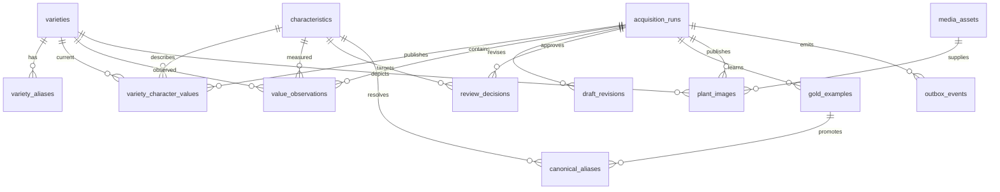

# 02. PostgreSQL KMS specification

## Prinsip dan grain

Database minimum PostgreSQL 15; deployment test disediakan untuk PostgreSQL 16. Namespace business data adalah `kms`. UUID digunakan untuk entitas; run_id mempertahankan identitas repo. `canonical_key` adalah identitas karakter stabil; label Indonesia boleh berubah dengan versi katalog yang terdokumentasi.

Skema memisahkan **master entities**, **current projection**, **immutable evidence**, dan **operational state**. JSONB dipakai untuk nilai yang bentuknya bervariasi dan provenance, bukan untuk menghilangkan foreign key. Tidak ada klaim bahwa satu nilai terkini mewakili semua pengamatan biologis suatu varietas.

## ERD



`audit_trace.run_id` sengaja bukan FK keras: audit juga merekam operasi katalog/media yang belum terikat run. `source_artifacts` menjadi registry arsip; run baru divalidasi ke registry oleh service. Legacy run tanpa source hanya dapat commit bila administrator secara eksplisit mengizinkan mode migrasi tersebut; default ditolak.

## Data dictionary inti

| Tabel | Kolom | Semantik |
|---|---|---|
| varieties | id UUID; canonical_name text unique | Nama kanonik dinormalisasi NFKC, whitespace dan casefold oleh kontrak aplikasi; bukan fuzzy entity resolution |
| varieties | origin_region text nullable; acquisition_date date nullable | Metadata terkurasi; null lebih baik daripada lokasi/tanggal palsu |
| varieties | metadata JSONB; created_at, updated_at timestamptz | Display name, metadata sumber yang terkontrol; bukan kredensial/log provider |
| variety_aliases | variety_id FK + alias text PK gabungan | Relasi multivalue 3NF; alias tidak globally unique karena homonim mungkin terjadi |
| characteristics | id UUID; canonical_key unique; label_id text | `label_id` di sini adalah label berbahasa Indonesia, bukan foreign key |
| characteristics | organ_domain nullable; source_domain text | Enam organ yang diminta, ditambah preservation domain sumber; lokasi tidak dipaksa menjadi organ |
| characteristics | data_type; standard_unit nullable; description | text/number/boolean/image/location. Unit/tipe tidak ditebak dari contoh |
| variety_character_values | id; variety_id FK; characteristic_id FK | Unique pair menentukan current projection, bukan histori seluruh pengamatan |
| variety_character_values | normalized_value JSONB; raw_source_value JSONB | Nilai bertipe dan kumpulan raw contributions; bukti lengkap tetap di observations |
| variety_character_values | value_type; is_multi_value | text, number, range, boolean, list. `range={min,max}` berbeda dari list |
| variety_character_values | confidence_score; status; run_id; version; updated_at | Status AUTO_ACCEPT/HUMAN_REVIEW. Confidence asli bukan sertifikasi kebenaran; version untuk optimistic concurrency |
| acquisition_runs | run_id; source_filename; file_sha256; source_uri | Hash adalah bytes workbook **sumber**, bukan hasil keluaran |
| acquisition_runs | schema_version; template_hash; config_fingerprint | Identitas katalog/config yang digunakan; tidak berubah dalam run yang sama |
| acquisition_runs | total_attributes; auto_accepted_count; reviewed_count | Jumlah atribut pemetaan, bukan jumlah sel atau variety-character pairs |
| acquisition_runs | execution_duration_ms; executed_at; ingested_at | Dua yang pertama boleh NULL untuk legacy; ingested_at waktu DB, bukan waktu lapangan |
| acquisition_runs | status; revision; payload_sha256; draft_payload; base_versions | STAGED/COMMITTED, canonical payload hash, snapshot review dan baseline current versions |
| acquisition_runs | receipt; committed_at | Diisi saat publikasi atomik; committed run tidak dapat direvisi langsung |
| plant_images | id; run_id; variety_id; organ_part; asset_id | Link ilmiah ke asset immutable; hanya accepted KNOWN yang dipublikasikan |
| plant_images | vision_confidence; vision_evidence; created_at | Bukti classifier, file ID, original/inference hashes dan transform version |
| media_assets | id; original_sha256; transform_profile | Identitas asset dari hash original dan transform profile; profile mencakup Pillow/libwebp |
| media_assets | original_uri; storage_uri; thumbnail_uri | Original privat; derivative WebP; thumbnail WebP 256x256 |
| media_assets | image_sha256; thumbnail_sha256; mime_type | Hash bytes masing-masing keluaran; MIME berdasarkan format hasil, bukan nama file |
| media_assets | file_size; original_size; thumbnail_size; width; height; created_at | Ukuran dalam bytes dan dimensi derivative |
| audit_trace | id bigint; run_id nullable; actor; event_type; entity_type | Urutan audit dan principal layanan yang terautentikasi |
| audit_trace | old_data; new_data; transaction_id; created_at | Before/after; payload draft penuh ada di draft_revisions agar audit run tidak menduplikasi snapshot besar |

Agar tetap 3NF, `local_aliases` tidak menjadi array yang diupdate bersamaan dengan relasi alias: gunakan view `kms.varieties_with_aliases`. Demikian pula metadata asset tidak diduplikasi di setiap link organ: view `kms.plant_images_with_media` menyediakan `storage_uri`, `thumbnail_uri`, `mime_type`, `file_size`, dan field relasional yang diminta. Ini memenuhi kebutuhan inspect tanpa dua sumber kebenaran.

## Data dictionary pendukung

`source_artifacts(sha256, storage_uri, file_size, created_at)` menyimpan sumber/output XLSX berdasarkan checksum. `catalog_versions(schema_version, template_hash, catalog_hash, definition, created_at)` menjaga snapshot taksonomi lengkap untuk KMS. Mengubah tipe/unit/organ existing canonical key memerlukan migrasi terkurasi; import biasa tidak boleh melakukannya.

`draft_revisions(run_id, revision, payload_sha256, payload, base_versions, actor, created_at)` append-only. `value_observations(id, run_id, variety_id, characteristic_id, observation_sha256, evidence, created_at)` menyimpan setiap contribution yang diterima. Unique constraint run/variety/character/evidence hash mencegah duplikasi replay dalam run yang sama.

`review_decisions` merekam item_id, keputusan, target nullable, actor dan evidence. `gold_examples` menambah source_scope, schema_version, template_hash, label normal, context_hash, target, decision, full example dan asal run. `canonical_aliases` menambah gold_id, evaluation_reference, reason, promoted_by serta kolom revocation. Indeks partial unique mencegah dua alias aktif berbeda untuk scope/schema/template/label/context yang sama.

`outbox_events` menyimpan event_id UUID, run, event_type, payload kecil, attempts, available_at, lease_token, leased_until, delivered_at, dead_letter_at, last_error_code. `schema_migrations` menyimpan versi DDL, SHA-256 file migration dan waktu penerapan. Mengedit migration yang sudah tercatat menghasilkan error checksum, bukan silent schema drift.

## Aturan nilai

Kontrak Python menolak NaN/Infinity, bool yang menyamar sebagai number, range terbalik, referensi karakter/varietas yang tidak ada, duplicate normalized identities, field ekstra, dan list kosong. SQL menjaga shape dasar JSON, unique/FK, confidence range, status, dan tipe multivalue. Validasi Python lebih kaya daripada CHECK SQL; user produksi mengakses API, tidak direct SQL editor dengan app credentials.

Catalog default adalah text kecuali lokasi/gambar. `config/characteristics_overrides.json` sengaja kosong karena unit/tipe seluruh template belum diaudit dari workbook pengguna. Isi hanya canonical key yang benar-benar ada dan telah disepakati. Untuk karakter numerik, normalisasi existing harus menghasilkan angka/range/list yang kompatibel dengan unit deklaratif; adapter menolak string ambigu, bukan meminta LLM mengisi angka.

## Transaksi commit

1. `stage` mengarsipkan payload immutable beserta baseline version per pair. Advisory lock run mencegah dua writer memodifikasi run bersamaan. SHA sama merupakan no-op; SHA berubah membutuhkan expected_revision saat ini.
2. Decision yang sudah final tidak dapat dikembalikan ke pending atau ditukar diam-diam. Set anggota review, identitas sumber/schema/config dan waktu run tidak boleh berubah.
3. `commit` memeriksa run/revisi/digest, pending reviews, serta source archive. Semua write berada dalam satu `Session.begin()` dengan synchronous_commit on.
4. Katalog diverifikasi, varieties di-upsert, observations ditambahkan, lalu current values diperiksa terhadap baseline. Pair locks diambil dalam urutan konsisten; `ON CONFLICT DO UPDATE ... WHERE version=expected` menjadi penjaga tambahan.
5. Nilai HUMAN_REVIEW existing tidak diturunkan oleh AUTO_ACCEPT baru (Decision D2: `EXISTING_HUMAN_PROTECTED`). Penimpaan otomatis ditolak dan menghasilkan review item `OVERWRITE_BLOCKED` atau `UNIT_MISMATCH`. Perubahan atribut yang disetujui kurator dicatat pada tabel append-only `kms.document_attribute_changes` melalui migrasi 0003 (`schema_0003_attribute_changes.sql`).
6. Keputusan review, gold, plant-image links dan outbox dimasukkan. Status/receipt diubah menjadi COMMITTED. HTTP success terjadi setelah context transaksi berhasil commit.
7. Retry request identik mengembalikan receipt dengan `replayed=true`. Konflik pair memerlukan inspect, curator rebase beralasan, dan commit ulang; histori lama tidak dibuang.

`ON CONFLICT` saja tidak menyediakan exactly-once lintas database/object store/provider. Object store dan DB sengaja menggunakan urutan write-before-reference. External effect sesudah commit dipublikasikan melalui outbox; consumer menyimpan event ID untuk deduplikasi.

## Preflight, migration dan izin

Preflight memeriksa PostgreSQL >=15, read-write connection, synchronous_commit dan keberadaan schema; API menolak runtime role yang superuser, dapat membuat role/database, bypass RLS atau anggota role pemilik schema. `cabai_migrator` membuat tabel; `cabai_app` tidak memiliki DDL/DELETE/TRUNCATE. Triggers menolak UPDATE/DELETE/TRUNCATE atas evidence dan audit.

Audit tidak kebal terhadap administrator database/root. Actor berasal dari bearer principal service, sementara nama pada form reviewer hanyalah `reported_reviewer`. Jangan mengklaim non-repudiation individu dengan token bersama. SaaS perlu OIDC, identitas user server-side, tenant scope/RLS, serta audit backup/WORM eksternal.

Migrasi auto-run tersedia melalui `DB_AUTO_MIGRATE=true` dengan `DATABASE_ADMIN_URL` terpisah dan advisory transaction lock. Default produksi **false**: jalankan migrasi sebagai release step; jangan memberikan admin secret kepada setiap worker API.

## Indeks dan query analitik

Indeks unique pair untuk current values, `(variety_id, characteristic_id, created_at DESC)` untuk histori, `(characteristic_id,status)` untuk seleksi karakter, file hash/run time, image variety/organ, audit run/id, partial active alias dan partial pending outbox. Tidak ada GIN pada semua JSONB secara membabi buta; ukur dengan EXPLAIN ANALYZE sebelum menambah index yang membebani write.

Contoh query berikut executable; label kunci dapat disesuaikan dengan katalog aktual.

```sql
-- Matriks current facts, termasuk unit dan confidence asli.
SELECT v.canonical_name, c.canonical_key, c.label_id,
       x.normalized_value, c.standard_unit, x.status, x.confidence_score
FROM kms.variety_character_values x
JOIN kms.varieties v ON v.id=x.variety_id
JOIN kms.characteristics c ON c.id=x.characteristic_id
ORDER BY v.canonical_name,c.canonical_key;

-- Rerata per karakter hanya untuk angka scalar; range/list tidak dipaksa menjadi rata-rata.
SELECT c.canonical_key,c.standard_unit,
       avg((x.normalized_value #>> '{}')::numeric) AS mean_value,
       count(*) AS n_current_varieties
FROM kms.variety_character_values x
JOIN kms.characteristics c ON c.id=x.characteristic_id
WHERE x.value_type='number' AND c.data_type='number'
GROUP BY c.canonical_key,c.standard_unit;

-- Quality operations: atribut mapping, bukan accuracy biologis.
SELECT date_trunc('day', ingested_at) AS day,
       count(*) FILTER (WHERE status='COMMITTED') AS committed_runs,
       sum(auto_accepted_count) AS auto_accepted_attributes,
       sum(reviewed_count) AS resolved_reviews,
       avg(execution_duration_ms) FILTER (WHERE execution_duration_ms IS NOT NULL) AS mean_runtime_ms
FROM kms.acquisition_runs
GROUP BY 1 ORDER BY 1 DESC;

-- Foto lengkap melalui view 3NF; URI privat bukan URL publik.
SELECT v.canonical_name,p.organ_part,p.storage_uri,p.thumbnail_uri,p.vision_confidence
FROM kms.plant_images_with_media p
JOIN kms.varieties v ON v.id=p.variety_id
ORDER BY p.created_at DESC LIMIT 100;

-- Seluruh contributions dari sebuah run: gunakan bind parameter pada aplikasi.
SELECT run_id,observation_sha256,evidence,created_at
FROM kms.value_observations ORDER BY created_at DESC LIMIT 100;

-- Backlog dan dead-letter outbox; alarm berdasarkan age, bukan count saja.
SELECT count(*) FILTER (WHERE delivered_at IS NULL AND dead_letter_at IS NULL) AS pending,
       count(*) FILTER (WHERE dead_letter_at IS NOT NULL) AS dead_letters,
       min(created_at) FILTER (WHERE delivered_at IS NULL) AS oldest_undelivered
FROM kms.outbox_events;
```

Untuk portal SaaS, tambahkan workspace/tenant ID pada seluruh entitas, composite uniqueness, run scope, alias scope dan object namespace, kemudian buktikan isolasi melalui test lintas tenant. Paket ini sengaja **single trusted research workspace**, bukan implementasi SaaS multi-tenant yang sudah selesai.

## Keputusan Arsitektur & Integritas Data

### Keputusan D2 (27 Oktober 2026): Perlindungan Nilai HUMAN_REVIEW & Pembatalan PRD A10
Nilai tersimpan dengan resolusi `HUMAN_REVIEW` berstatus dilindungi (`EXISTING_HUMAN_PROTECTED`). Pengukuran baru berstatus `AUTO_ACCEPT` tidak dapat menimpa nilai tersebut secara otomatis. Penimpaan hanya diizinkan melalui review manusia oleh peran `curator` dengan alasan tertulis wajib (`reason`). Aturan PRD A10 / "Decision #2" yang mengizinkan AUTO_ACCEPT menimpa HUMAN_REVIEW resmi **DIGANTIKAN oleh D2 (27 Okt 2026)**.

### Migrasi 0004 (28 Oktober 2026): Antrean Kandidat Citra (kms.image_candidates) & Indeks Citra Ditolak (kms.discarded_images)
Migrasi aditif `schema_0004_image_candidates.sql` memperkenalkan dua tabel baru untuk mendukung penanganan citra varietas baru tanpa pembuangan otomatis (Keputusan D10–D13):
1. `kms.image_candidates`: Menyimpan entri citra berstatus `CANDIDATE` dengan referensi FK unik ke `kms.media_assets(id)`. Mendukung tiga aksi resolusi: `PROMOTE` (varietas baru dengan dukungan `habitat_unknown`), `MERGE` (tautkan ke dokumen aktif), dan `DISCARD`.
2. `kms.discarded_images`: Mencatat `original_sha256` beserta alasan kurasi (`reason`) untuk mencegah citra yang sama diajukan kembali pada akuisisi berikutnya.
Hak akses minimal `SELECT, INSERT, UPDATE` diberikan kepada role aplikasi `cabai_app`. Integritas checksum diverifikasi sekuensial oleh `migrate.py` dan dicek pada probe kesiapan `/readyz`.

